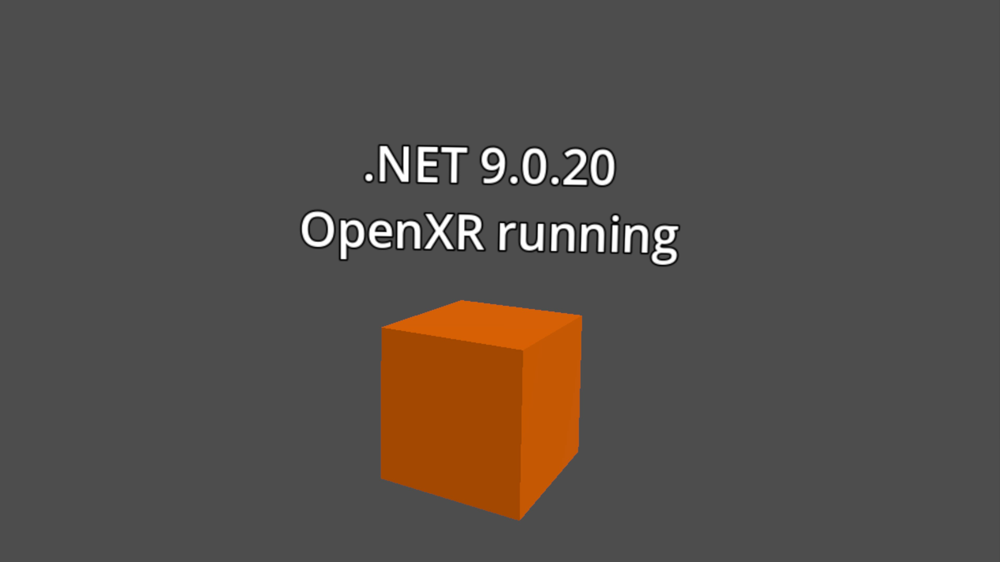

# Dev diary 1: a C# cube on the Quest 3

*6 to 8 October 2026. Milestone 0, the engine spike.*

## Short version

I'm rebuilding the forest level of Panzer Dragoon Zwei for the Quest 3, using the art from my own Saturn disc. Three days in, there is nothing from the game on the headset yet. What there is: an orange cube, spinning, drawn by C# code running in Godot on the Quest. That was the biggest unknown in the whole project, and it works.

## Why a cube

Godot's own documentation calls C# on Android "experimental", and there are open bug reports of C# apps crashing at startup on Android. I want to write this in C#, so that had to be settled before anything else was built on top of it.

The test was deliberately the smallest thing that could prove it: one cube, rotated every frame by C# code, with a label showing the .NET version the code is running on. If the label shows a version number, C# is alive on the headset. It shows .NET 9.0.20.

## What the project is

- **The goal:** ride the dragon through Episode 3, the forest, in VR, with a full view all around. A playable demo within a year.
- **The rule:** nothing copyrighted goes in the repo or in the app. A PC tool reads your own disc and writes ordinary image and model files; the game ships empty and loads them from a folder on the headset.
- **The design:** no HUD bars. Health is the dragon's colour, hits are a buzz in the controller, sounds come from where things are. The left hand aims a reticle, the trigger fires, a held button locks on to up to four targets.

## Day 1: the disc gives up its textures

Before any VR work, I wanted to know whether the original art could be extracted at all. I found no documentation for Zwei's formats, so this was worked out from the disc itself.

- The disc is an ordinary file system with 308 files, named by episode. The forest level is about 2.5 MB.
- Texture files turned out to be raw pixels with no header. The size, position and palette of each texture are stored in the matching model file, in the same layout the Saturn's graphics chip uses.
- With that understood, 9,020 textures came out of the disc. About half decode in full colour. The dragon is recognisable straight away: blue hide, pink wing membranes.
- The other half are 256-colour textures whose palette lives somewhere I haven't found yet. They come out grey for now.

## Day 1, later: the forest floor

The floor and canopy of the forest are not models. The Saturn drew them as flat images, tilted and scrolled to fake depth. They weren't in any of the texture files.

I found them by playing the level in an emulator, saving the game's state mid-flight, and reading the images out of the emulated video memory. Each is 512 by 512 pixels and built to tile. The floor is dark leaf litter; the canopy is bright green with patches of sunlight coming through.

This is a real find and also a problem. My extractor is supposed to work from the disc alone, and I still don't know which file on the disc these images are stored in.

## Day 2: planning and tools

- Wrote the spec: nine capabilities, from "a VR scene on the Quest" to "destroy four real Zwei enemies with one lock-on volley".
- Split it into six pieces of work and broke the first one, the engine spike, into eight small steps.
- Installed the build tools on the Steam Deck: Godot 4.7.2, .NET 9, Java 17 and the Android SDK. About 3.5 GB, all in the home folder, installed by one script that can be run again safely.

Yes, the dev machine is a Steam Deck.

## Day 3: onto the headset

Two things went differently from the plan.

1. **The simple export doesn't do VR.** Godot has a quick way to build Android apps and a slower one that goes through Gradle. The quick one produced an app with no OpenXR support in it at all. The slower one works. Meta's own plugin for Godot turned out not to be needed.
2. **The Quest wouldn't start the app while it sat on the desk.** It holds new launches behind a "controller required" prompt until someone picks up a controller. For a while it looked as if the app wasn't starting. It was waiting for me.

Then I put the headset on, and there was the cube.

The build is one command now: it builds the app, installs it on the headset and launches it.

## What I don't know yet

- Where on the disc the forest floor and canopy are stored.
- Where the 256-colour palettes are.
- How the 3D models are stored. I can read their textures but not their shapes, which blocks the dragon and the enemies.
- Whether enemy flight paths are recorded or calculated. One of the level's data files is full of stored rotations and positions, which hints at recorded.
- Whether this holds 90 frames a second with a real scene in it.

## Next

Decide the format of the manifest that the extraction tool writes and the game reads. Then a proper test scene: a ground, a sky and a cube flying around me, at 90 Hz.

---

*I'm building this with Claude Code doing much of the typing and the reverse engineering alongside me.*
