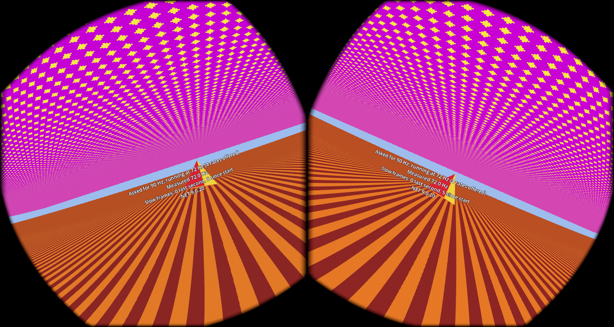

# Dev diary 2: things loaded from outside the game

*8 to 15 October 2026. Still milestone 0, the engine spike.*

## Short version

The game on the Quest now reads pictures and a 3D model from a folder on the headset, at launch, and puts them in the scene. Nothing from Panzer Dragoon is in it yet, but the route the extracted art will take is now proven end to end. Along the way I changed my mind about where extraction happens: it moves from a PC tool onto the headset.

*A raw capture of both eyes. The stripes, the dots and the pyramid are all test files copied onto the headset, not built into the game.*

## The game always runs

The game ships with no Zwei art, so the first question was what it shows before any has been supplied. The answer: its own placeholders. Plain chequered ground and sky, and a grey cube where an enemy will fly.

Each placeholder has an ID, such as `e03.floor` for the forest floor or `e03.flyer` for the flying enemy. If the folder on the headset supplies a file for that ID, the game uses it instead. If it doesn't, or the file is broken, the placeholder stays. The game never refuses to start.

A small manifest file lists what is in the folder: each file's ID, its kind, and its exact size. A PC script writes the manifest automatically from file names, so a file called `e03.floor.png` becomes the floor.

## A test scene, and 72 Hz

The orange cube became a scene: a ground, a sky and a grey cube circling me. A small readout shows the frame rate.

I wanted 90 frames a second. The headset gives 72. After adding Meta's plugin for Godot, the headset offers four refresh rates and accepts the request for 90, then keeps running at 72 anyway. Its own home screen does the same. Still unexplained.

## The flat sky

The sky was meant to be a blue chequer pattern. On the desktop it was. On the Quest it came out as one flat colour.

This one took a while. The texture on the sky wasn't repeating on the headset: past the first tile, every pixel took the colour of the texture's edge. The fix was a small shader that wraps the coordinates itself instead of trusting the texture's repeat setting. I still don't know why the headset behaves differently from the desktop there.

## Testing without wearing the headset

Two discoveries made the headset much easier to work with from the Steam Deck:

- A command keeps the headset awake on the desk, and another takes a screen capture over USB. So a build can be installed, launched and looked at without anyone putting it on. About ten build-and-capture rounds of the sky problem went that way.
- The headset deletes an app's log shortly after the app closes. Reading the log while the app is still running fixed what looked like a broken logger.

Meta's plugin also removed the "controller required" prompt that used to hold every launch, which is what made unattended launches possible.

## A change of plan: extraction on the headset

The original plan was a PC tool: run it on your disc image, copy the results to the headset. I changed my mind. Now you copy your own disc image (bin/cue or ISO) to the headset, and the game extracts what it needs at launch.

- The code that understands the Saturn's formats becomes one C# library. The game runs it on the headset, and a PC command runs the same code so I can still decode to a folder of pictures and check them by eye.
- While developing, the game keeps the disc image and re-extracts every launch, so improvements show up immediately. A release build extracts once and deletes the image.

Nothing from the game ever goes in the repository or the app.

## Pictures, a report, and a model

With the folder rules settled, three things landed in a row:

1. **Pictures.** Two test images replaced the ground and sky placeholders. The striped ground came out looking like Green Hill Zone.
2. **A launch report.** When something is wrong with the folder, a board stands in front of you listing each problem, such as which file is missing. It stays up for as long as the game runs.
3. **A model.** A small pyramid, written by a script as a standard 3D file, flies in place of the grey cube. Delete the file and the grey cube comes back, with the board saying what's missing.

The models use a standard format, binary glTF, with their textures inside. Several of its finer rules are marked provisional until the Saturn's own models are decoded and I can see what they really need.

## What I don't know yet

- Why the display stays at 72 Hz.
- Where on the disc the forest floor and canopy images are stored.
- Where the 256-colour palettes are.
- How the 3D models are stored on the disc.
- Whether enemy flight paths are recorded or calculated.

## Next

Find out about 72 Hz, tidy up, and close the engine spike. Then the extraction work starts properly: the first Zwei textures decoded on the headset itself.

---

*I'm building this with Claude Code doing much of the typing and the reverse engineering alongside me.*
