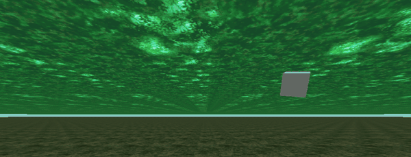

# Dev diary 4: the forest floor and canopy

*29 October 2026. Milestone 2, the forest.*

## Short version

The forest is in. Episode 3's floor and canopy now come off your own disc, decoded on the headset, and fly past you in VR: mossy ground below, a ceiling of leaves above. Neither plane actually moves. The images slide across them, wrapped so they never run out, and the canopy is timed to match the floor so it reads as one flat, closed-in tunnel, as it does on the Saturn.

*Five seconds of the game's own render, recorded on the desktop with Godot's movie maker. In the headset the floor and canopy wrap all the way around you.*

## Two planes, not two textures

When I looked at the floor in the last diary's save state, it wasn't a texture on a polygon at all. Zwei draws the forest's ground and ceiling with the Saturn's background chip, VDP2, as its rotating layer, RBG0. That layer has two planes, A and B, which the game switches between with a window: A is the floor, B the canopy.

Each plane is one 512 by 512 pixel page, built from 16 by 16 pixel cells in 256 colours, with a map saying which cell goes where. The floor's map is just its 256 cells in order, repeated twice each way, so the floor repeats every 256 pixels. The canopy's map is cleverer: 188 cells arranged so its left and right halves match but its top and bottom don't, so it repeats every 256 pixels across and 512 down.

## Where they were hiding

None of this was in the texture files. I searched every file on the disc for the cells as they sit in video memory, and found nothing: they're packed.

The way in was the code. The Episode 3 program file holds the address of VDP2's video memory as a 32-bit number, and the code next to it is the routine that fills it. It does three things:

1. copies 256 colours, stored plainly in the file, into colour RAM;
2. calls the core engine's unpacker on a stream that becomes the cells;
3. unpacks the two maps through a short list of pointers.

The packing is a straightforward LZ77 variant: a flag bit per item, read least significant bit first, choosing between a literal byte, a short copy back up to 256 bytes and a long copy back up to 8,192. A long copy of zero ends the stream. A little Python probe unpacks all three, and they match the save state byte for byte, cells, maps and colours, on both my Japanese disc and the European one. On the European disc everything sits 28 bytes earlier in the file and the code 4 bytes later, so the extractor finds the data by searching for those addresses rather than trusting fixed offsets.

From there it was a port: the probe's unpacker and renderer moved into the C# decoding library, and extraction now writes the floor and canopy as two 512 by 512 PNGs beside the textures. The headset and the PC write exactly the same 423 files.

## Scrolling without moving

The obvious way to fly through a forest is to move the camera, or the world. I do neither. The floor and canopy are each a flat plane 2,000 metres across, centred on you, and they stay put.

What moves is the image. The shader that draws each plane works out which point of the image belongs at each pixel. I add an offset to that, in units of one copy of the image, and every frame the offset shrinks a little in the direction of flight, by speed times the frame's time divided by the size of one copy. The pattern slides towards you and under you.

Two details keep it clean:

- **The offset never grows.** After each step it's wrapped back into the range 0 to 1, one copy of the image, so after an hour of flying it's as precise as it was at the start. Because the image tiles seamlessly, jumping back exactly one copy is invisible.
- **The wrap happens in the shader, not the texture.** On the Quest 3, a texture set to repeat came out clamped to its edge on these planes, one flat colour. So the shader wraps the coordinates itself and samples with the gradients of the unwrapped coordinates, which keeps the smaller distance copies of the image correct across the wrap instead of showing a seam.

## Why the canopy moves faster

If the floor and canopy scrolled at the same speed in metres, the canopy would look sluggish: it's further away, so the same distance covers a smaller angle. On the Saturn the canopy is a flat backdrop that keeps pace with the floor on screen, with no parallax.

So the canopy is timed by angle, not distance. A point straight overhead at height *h* above your eye crosses the same angle each second as a point straight below at depth *d* when the canopy's speed is the floor's times *h* over *d*. With my settings the floor is 7.6 metres below my eye and the canopy 8.4 above, so it runs a touch faster than the floor. The ratio is a setting, so I can still make it lag or rush if a later scene wants it.

## Tuning it by eye

Every number here is in a small `tuning.json` I can push to the headset with one command, so trying a new look means editing a file and relaunching, not rebuilding. I tuned it in the headset against Mednafen running the real game:

- My first guess, canopy 30 metres up, felt wrong at once: open and repetitive. In the game, Episode 3 is claustrophobic. Dropping the canopy to 10 metres was "much better", and it made the repeating pattern less obvious too, because each copy now fills more of your view.
- The floor sits 6 metres below the dragon's back. The dragon has to clear the ground by at least 3 metres, and the extra leaves room for its body under you.
- The floor's 512-pixel page covers 24 metres, about three quarters of a metre per cell, and the canopy's covers 48.
- I fly at 6 metres a second. That looks slower than it sounds, with the floor this far down.

The settings also have limits now, chosen so nothing you can type breaks the picture: the canopy can't come down through your head, images can't shrink until they shimmer, and the floor can't sink so far that its edge shows.

## What's next

The forest's sides. Watching the game in Mednafen, the forest closes in with walls of trunks, vines and mossy mounds. Those are 3D models, not background planes, and they wait on the next big unknown: how the `.MDB` files store model geometry. The dragon needs that too, so it's the next spike.

---

*I'm building this with Claude Code doing much of the typing and the reverse engineering alongside me. Nothing from the disc goes in the repository: the animation above was made from my own disc's extraction and lives only beside this post, not in the code.*
