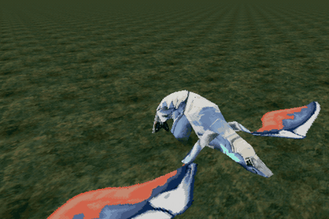

# Dev diary 5: the dragon beats its wings

*10 November 2026. Milestone 3, riding the dragon.*

## Short version

The dragon under you now flaps. Its wing beat comes off your own disc, like everything else: each dragon form has a motion file beside its model, and the extractor turns form 9's wing beat into a glTF animation that the game loops at the Saturn's 30 frames a second. The body, neck, tail and legs move with the wings. The dragon as a whole stays put, so the seat doesn't move under you.

*One wing beat, 1.8 seconds, rendered by the game on the desktop with Godot's movie maker, seen from in front and to one side. In the headset you're sitting on its back.*

## Where the motion was hiding

The last epic got the dragon's shape off the disc: each of the ten forms is a `.MDB` file holding a tree of 27 body parts, with a matrix for each part. That gave a dragon frozen in one pose. Beside each `.MDB` and its textures sits a third file, `.MTB`, which nothing had opened yet. It was the obvious suspect, and it was guilty.

An `.MTB` is a list of poses. Each pose gives 24 of the 27 body parts a record of six numbers: a move (x, y, z) and three turns. The other three parts, two hip joints and an empty node, just keep their pose from the `.MDB`. A few details took some prodding:

- **The units.** Moves are in sixteenths of the model's units, and turns are in 4,096ths of a full circle, the Saturn's usual way of storing an angle in a 16-bit word.
- **The order of the turns.** Three turns can be applied in six orders, and only one is right. I took the save state from my Episode 3 run in Mednafen, read the 24 live matrices out of the Saturn's memory, and rebuilt them from every frame of the motion in all six orders. One order, turn about Y, then X, then Z, matches frame 25 of form 9's first motion to within 0.00004 on every number. No other frame or order comes close.
- **The split.** A pose isn't stored in one piece. It comes in three blocks: neck, head and tail; root, hind legs and trunk; and the two wings. Each block has its own list of pointers. That's why the file sizes looked so odd at first: every frame costs 300 bytes once you add up the three blocks and their pointers.

## Which motion is the wing beat

The `.MTB` doesn't say where one motion ends and the next begins. That list lives in the game's main program, `1ST_READ.PRG`: twelve slots per dragon form, each with the three block pointers and a frame count. The code that picks the slots, traced in Ghidra, says which loop and which play once and hand back. The wings' angles say what they are:

- **Slot 0 is the wing beat** in all ten forms. Form 9's is 54 frames and loops: the wings start level, rise to the top at frame 9, beat down to the bottom at frame 26, then come back up slowly.
- **The others** are a glide, raising the wings, lowering them, and holding them up.

There was one red herring. Each `.MDB` holds 30 extra wing pieces I'd guessed were flapping frames. They aren't. They're 15 shapes for each wing, which the game swaps in while it raises or lowers the wings. During the ordinary wing beat the wings keep their normal shape.

The extractor finds the slot table the same way it finds the rider's seat, by searching the program for the forms' own data rather than trusting a fixed address. It sits 0x54750 bytes into the Japanese program file and 0x547EC into the European one.

## Proving it on the PC first

Before touching the game, a throwaway script drew form 9 at every frame of slot 0. Seeing the wings go up at frame 9 and down at frame 26 settled that I was reading the file right. Then the real work went into the C# decoding library: each dragon model the extractor writes now carries its wing beat as a glTF animation. Here it is in F3D, a plain glTF viewer that knows nothing about Zwei:

*The extracted `dragon_ride.glb` playing in F3D. The black around the wings is F3D drawing the see-through pixels; the game draws them clear. The timeline ends at 1.77 s, the last key; the game holds that frame for its full thirtieth of a second.*

## Keeping the model's shape

The dragon's model doesn't store the 27-part tree. To keep the files simple, each part with a mesh sits side by side under the root, its pose from the `.MDB` already built into its corners. So the animation can't just replay the `.MTB`'s turns part by part down the tree.

Instead, for every frame the extractor walks the tree, multiplying each part's turn and move into its parent's, as the Saturn does. That gives the frame's whole turn for every part. It then takes away the rest pose already built into the part, and the key is what's left: how far that part has turned and moved since its rest pose at this frame. One key per frame per part, stepped, with no blending in between, because the Saturn doesn't blend either: it shows whole frames.

I left one thing out on purpose. In the game the whole dragon bobs and pitches with every beat, the root of the tree rising and dipping. In VR you're sitting on it, and a seat that bobs while your head stays still is a fast way to feel ill. So the root keeps its rest pose, and only the parts move.

## The same bytes on two machines

One rule shapes everything the extractor does: it writes exactly the same files on the PC and on the headset. The two run different versions of .NET, and that rule has caught real problems before.

Animation brought a new danger. Turning an angle into a rotation normally means sine and cosine, and those library functions aren't promised to give the same last bit on every machine. One bit different in one key and the files no longer match. So the extractor doesn't call them. It builds its own sine table from integers alone, does the tree's multiplications in whole numbers as the model decoder already did, and turns the result into glTF's rotations with nothing fancier than adding, multiplying, dividing and one square root. All of those come out the same everywhere.

The check is the same as ever: extract on the headset, extract on the PC, compare. All 434 files matched, the new animated models included.

## Playing it in Godot

Godot's glTF loader turns an animation in a model into an animation player, so the game's side is small. When the ridden dragon's model arrives, the game finds that player, sets the animation to loop, tells every track to step rather than blend, and starts it.

There was one off-by-one to catch. Godot ends an animation at its last key, so frame 53 flashed past and the loop jumped straight back to frame 0, 1.77 seconds in place of 1.8. The fix makes the loop one frame longer than its last key, so the last frame is held as long as the others.

The rate is 30 frames a second. That's the rate the Saturn game itself runs at, so form 9's beat takes 1.8 seconds, slow and heavy, like something big holding itself in the air. A dragon model without an animation, such as the grey placeholder or one you made yourself, is simply shown still.

## What's next

The dragon flies, after a fashion: it beats its wings, and the forest slides past underneath. What it can't do is steer, and nothing in the forest is shooting back yet. Next comes aiming and lock-on, the other half of what makes Panzer Dragoon what it is.

---

*I'm building this with Claude Code doing much of the typing and the reverse engineering alongside me. Nothing extracted from the disc goes in the repository. Both animations above were made from my own disc's extraction: the game's own render is kept with this post, and the F3D one stays on my machine.*
